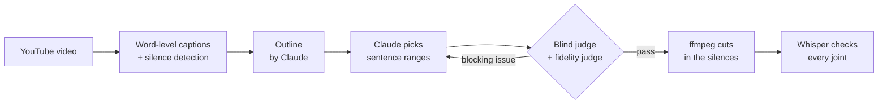

# TheoLDR

**A 45-minute Theo video becomes a 9-minute TLDR and a 2-minute TTLDR. Every word in them is Theo's, in his original order.**

TheoLDR shortens [Theo's](https://www.youtube.com/@theo) YouTube videos **by cutting only**. Nothing gets added and nothing gets moved. Claude decides what to keep and ffmpeg cuts in the gaps between words, so the result still sounds like Theo talking.


## Demo

Start with the TTLDR, then compare with the original.

| [Coding Isn't About Code Anymore](https://youtu.be/GtJKFhztgdM) | Length |
|---|---:|
| **[TTLDR](https://youtu.be/YS2yVlP-1ms)** | 1:44 |
| [TLDR](https://youtu.be/vPECheshXu4) | 9:04 |
| [Original](https://youtu.be/GtJKFhztgdM) | 45:21 |

## Results

Real runs on recent videos:

| Video | Original | TLDR | TTLDR |
|---|---:|---:|---:|
| [Anthropic Made Claude Even Better](https://youtu.be/FsDUOUV9Vs8) | 70 min | 12:14 | 1:53 |
| [My last video about AI harnesses](https://youtu.be/ebILGCoN4UU) | 49 min | 9:43 | 1:33 |
| [Nobody Is Competing With Anthropic](https://youtu.be/yh5IAUow4Hc) | 48 min | 10:08 | 1:45 |
| [Coding Isn't About Code Anymore](https://youtu.be/GtJKFhztgdM) | 45 min | 9:04 | 1:44 |
| [T3 Code broke me](https://youtu.be/uLGxb4F3SyI) | 42 min | 9:11 | 1:57 |
| [OpenAI is getting desperate](https://youtu.be/Hq2c7pww1Ds) | 16 min | 5:14 | 1:50 |

A 40-minute video usually gives a TLDR of 8 to 10 minutes, about 5 times shorter, and a TTLDR short enough for a tweet.

## How it works



## Why the cuts don't sound broken

The agent never picks timestamps. It picks sentence IDs, and the cut points come from real silences in the audio. A range can only start or end on one of them, so no word gets clipped in half.

Two judges review every attempt. The first one is blind: it runs isolated, without tools, and only sees the kept text, like someone who never watched the original. If a line points to something that was cut ("as I said", "that one"), it complains. The second one reads the whole transcript and checks that the short version doesn't twist what Theo said or drop the caveat that mattered.

Feedback to the agent stays narrow on purpose. Ask it for "more coverage" and it starts gluing in tiny fragments until the video turns into confetti. So revisions only get the blocking issues.

Finally, Whisper listens to the finished video and checks that the words on both sides of every cut are really there. Sponsors are gone too, thanks to SponsorBlock, or to the agent itself when a video is too new for SponsorBlock.

## Quick start

Works on macOS, Linux and Windows. You need [uv](https://docs.astral.sh/uv/), `ffmpeg`, `node` and a logged-in [Claude Code](https://claude.com/claude-code) CLI (on Windows, use its native installer). The Whisper check runs on MLX on Apple Silicon and on [faster-whisper](https://github.com/SYSTRAN/faster-whisper) elsewhere.

```bash
git clone https://github.com/alexandreeberhardt/TheoLDR.git && cd TheoLDR
uv sync --extra qa
uv run --extra qa theoldr latest              # latest long video not done yet
uv run --extra qa theoldr run <url-or-id>     # a specific video
uv run theoldr status                         # what has been processed
```

A run takes 5 to 15 minutes, mostly Claude calls. Each step saves its result, so a crashed run picks up where it stopped. You get these files in `videos/<id>/`:

- `tldr.mp4` (5 to 15 min) and `ttldr.mp4` (1 to 2 min)
- `post.txt`, a draft post with a link to the original
- `qa.json` and `sheet_*.jpg`, with scores, Whisper checks and a frame before and after every cut

Want different cuts? Edit the sentence ranges in `selection.json` and run again: only the render is redone. More details in [`CLAUDE.md`](CLAUDE.md).

## Credits

All content belongs to [Theo](https://x.com/theo). TheoLDR only removes parts of his videos.

If TheoLDR helps you keep up with Theo, **leave a star** ⭐ and go watch the full videos too.
